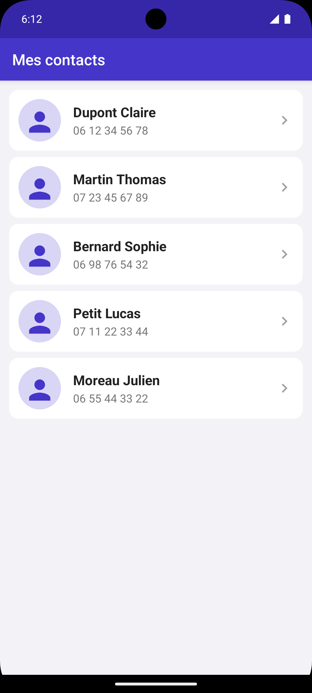
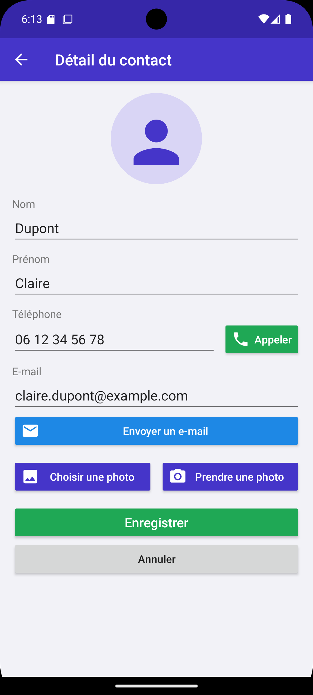
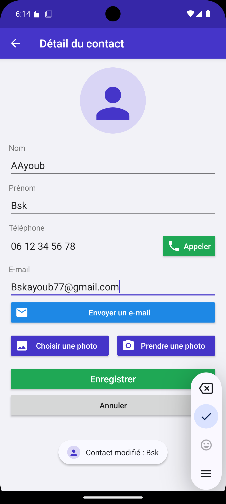
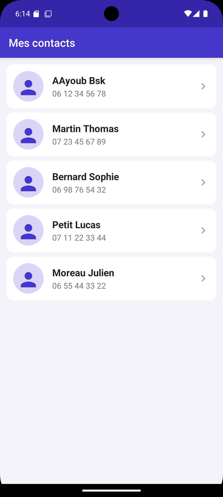
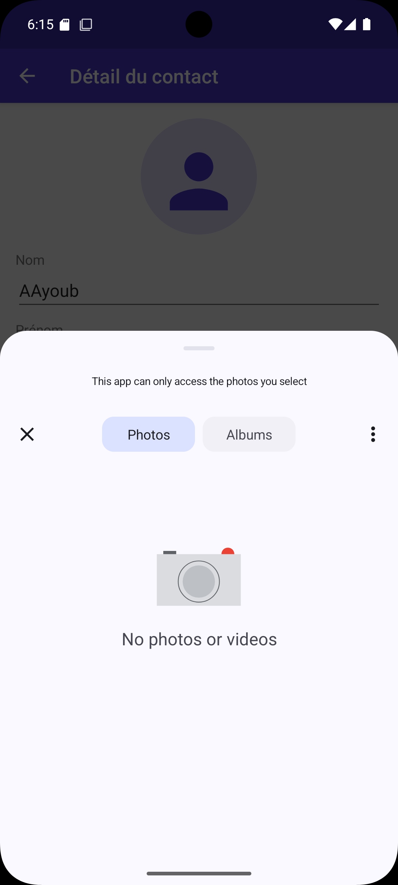
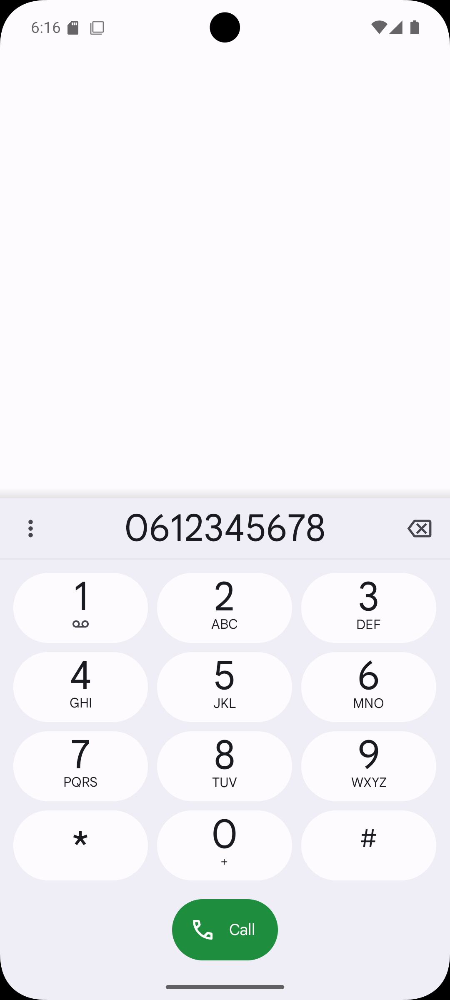
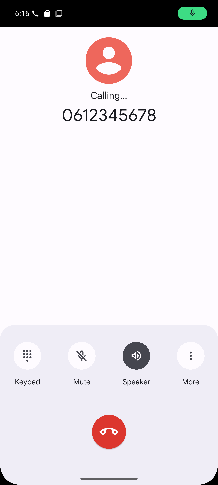

# Contacts V2

TP Android Kotlin — Ayoub Boussoukaya, L3 DSI

Application de contacts avec deux écrans : la liste (MainActivity) et le détail d'un contact (DetailActivity).

## Fonctionnalités

- Liste personnalisée (ListView + adaptateur) : photo, nom, prénom, téléphone
- Clic sur un contact : Intent explicite vers DetailActivity
- Modification du nom, prénom, téléphone et e-mail
- Bouton Appeler (ACTION_DIAL) et bouton E-mail (ACTION_SENDTO)
- Photo depuis la galerie ou l'appareil photo
- Enregistrer : retour de résultat à MainActivity, la liste se met à jour
- Annuler : retour sans modification
- Gestion des erreurs : champs vides, photo annulée, aucune application, caméra refusée ou absente

## Captures

| Liste | Détail | Modification | Liste modifiée |
|:-:|:-:|:-:|:-:|
|  |  |  |  |

| Galerie | Caméra | Appeler | Appel | E-mail |
|:-:|:-:|:-:|:-:|:-:|
|  |  |  |  |  |
